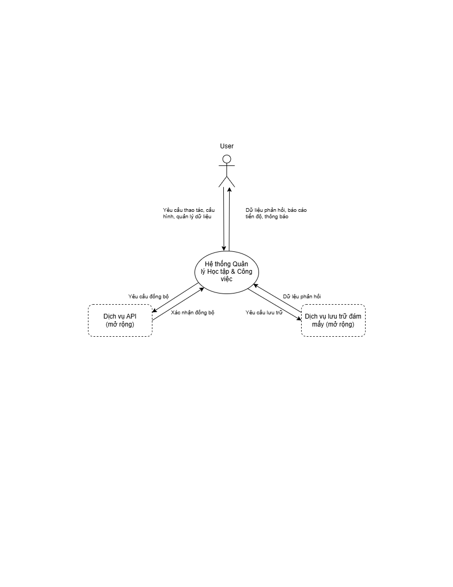
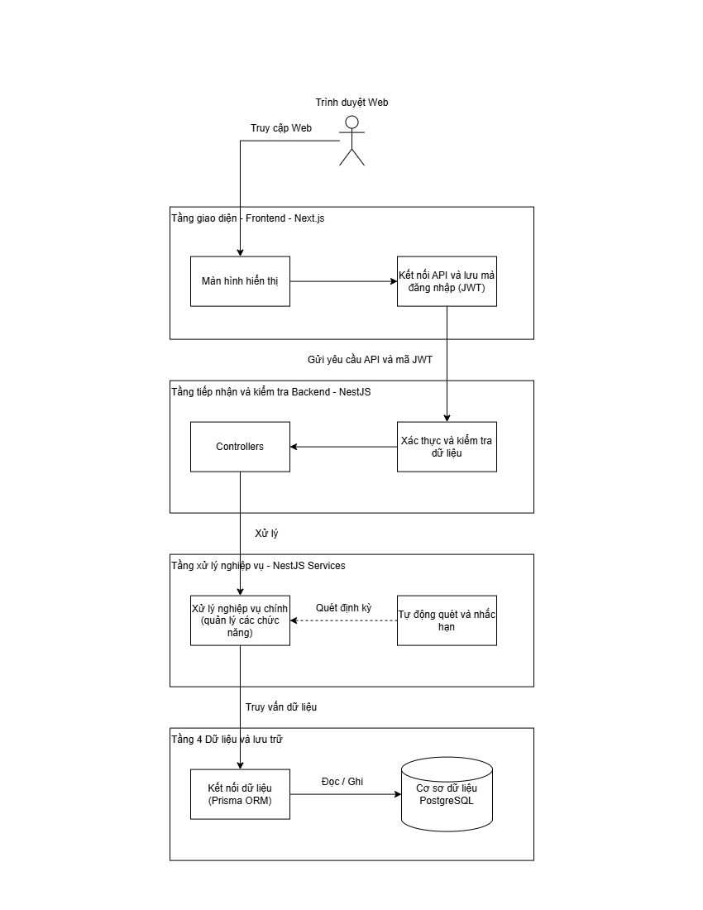

# 04_System_Architecture.md — Kiến trúc hệ thống

> Tài liệu trước: [03_Functional_Analysis.md](03_Functional_Analysis.md)
> Tài liệu sau: [05_Domain_Model.md](05_Domain_Model.md) và [06_Database_Design.md](06_Database_Design.md)

---

## 1. Context Diagram (Sơ đồ ngữ cảnh)

> Hệ thống kết nối với ai/cái gì bên ngoài? Xác định ranh giới hệ thống (System Boundary).

```
Sơ đồ: ../diagrams/04_Context_Diagram.drawio
Export: ../diagrams/exports/04_Context_Diagram.png
```



**Actors bên ngoài:**
- **User (Người dùng cuối):** Học sinh, sinh viên, người đi làm. Tương tác qua trình duyệt web trên máy tính hoặc thiết bị di động.
  - Gửi yêu cầu: Đăng ký/đăng nhập, thao tác dữ liệu (Task, Note, Event, Reference), cấu hình Space, thiết lập liên kết (Relation).
  - Nhận phản hồi: Giao diện trực quan hóa, danh sách công việc, thông báo nhắc hạn và số liệu thống kê Dashboard.
- **Biên giới hệ thống (System Boundary):**
  - Hệ thống vận hành độc lập (Self-contained).
  - Giai đoạn MVP chưa tích hợp trực tiếp với các dịch vụ bên ngoài (như Google Calendar, Google Drive Sync) nhằm tập trung tối đa cho tính ổn định của mô hình dữ liệu lõi.

---

## 2. High-Level Architecture

> Hệ thống được tổ chức thành các tầng nào và luồng dữ liệu chính di chuyển ra sao?

```
Sơ đồ: ../diagrams/04_System_Architecture.drawio
Export: ../diagrams/exports/04_System_Architecture.png
```



**Mô tả luồng chính:**
- **Trình duyệt Web (Client):** Người dùng tương tác qua giao diện web.
- **Next.js (Frontend):** Phục vụ giao diện người dùng, quản lý routing (App Router) và gửi yêu cầu REST API (kèm JWT).
- **NestJS (Backend):** Tiếp nhận API, kiểm tra xác thực (Guard), validate dữ liệu (Pipe), xử lý logic nghiệp vụ phân tầng (Service) và chạy tác vụ ngầm quét hạn (Scheduler).
- **Prisma ORM:** Lớp truy cập dữ liệu trung gian, thực thi truy vấn kiểu an toàn, quản lý transaction và migration.
- **PostgreSQL (Database):** Lưu trữ toàn bộ dữ liệu quan hệ của hệ thống.

**Giải thích phân tầng:**
1. **Presentation Layer (Next.js):** App Router, React Components, CSS Modules, TanStack Query (gọi API và đồng bộ dữ liệu).
2. **API & Controller Layer (NestJS):** REST Controllers, JwtAuthGuard, ValidationPipe, Global Exception Filter.
3. **Domain & Business Layer (NestJS Services):** Thực thi toàn bộ quy tắc nghiệp vụ Kiến trúc Lần 3 (Object, Space, Placement, Relation, View, Notification).
4. **Data Access & Persistence Layer (Prisma ORM & PostgreSQL):** Đảm bảo toàn vẹn dữ liệu, quan hệ khóa ngoại và tối ưu hóa chỉ mục B-Tree.

---

## 3. Danh sách Module & Dependency

> Backend NestJS gồm các module độc lập; thuật toán tách thành hàm thuần để kiểm thử riêng. Cấu trúc thư mục chi tiết: xem [09_Implementation.md](09_Implementation.md).

| Module | Trách nhiệm | Phụ thuộc vào |
|---|---|---|
| **PrismaModule** (global) | Kết nối CSDL dùng chung | — |
| **AuthModule** | Đăng ký, đăng nhập (JWT), hồ sơ, đổi/quên/đặt lại mật khẩu, khoá tạm chống dò mật khẩu | Prisma, Mail |
| **SpacesModule** | Không gian: CRUD, tiến độ, ghim/sắp xếp, công cụ bật/tắt, mẫu dựng sẵn | Prisma |
| **ObjectsModule** | **Hạt nhân:** CRUD Task/Note/Event/Reference, vòng đời, chuyển loại, gán nhiều Space, phân trang | Prisma, Knowledge, Notifications, Recurrence |
| **RelationsModule** | Liên kết giữa Object; luật phụ thuộc/việc con, cấm vòng | Prisma, Planning (graph) |
| **ViewsModule** | Kanban, Lịch, Dashboard tổng quan | Prisma |
| **PlanningModule** | Trụ Kế hoạch: gợi ý "Hôm nay làm gì?", việc bị chặn, mức tải | Prisma |
| **StudyModule** | Trụ Học tập: thẻ ôn, SM-2, phiên tập trung, thống kê | Prisma |
| **KnowledgeModule** | Trụ Tri thức: `[[ ]]`, đồ thị tri thức | Prisma |
| **RecurrenceModule** | Luật lặp, sinh lần kế tiếp (cron mỗi 15 phút cho Event) | Prisma |
| **NotificationsModule** | Thông báo: quét định kỳ (5 phút), bản tin 07:00, cài đặt, chống trùng | Prisma |
| **CalendarModule** | Xuất lịch `.ics` bằng token bí mật | Prisma |
| **ReportsModule** | Báo cáo tuần | Prisma |
| **AccountModule** | Xuất dữ liệu cá nhân | Prisma |
| **AdminModule** | Quản trị: người dùng, thống kê, thông báo hệ thống, nhật ký | Prisma, Notifications |
| **MailModule** (global) | Gửi email qua SMTP; chưa cấu hình thì ghi ra log | — |

---

## 4. Decision Log (Lý do chọn công nghệ và thiết kế)

> Mục này quan trọng khi bảo vệ — hội đồng hay hỏi "Tại sao em chọn X mà không chọn Y?". Lịch sử các quyết định chi tiết hơn: `plan/02_Quyet_Dinh.md`.

| Quyết định | Lựa chọn | Thay thế đã xem xét | Lý do |
|---|---|---|---|
| **Mô hình dữ liệu lõi** | **Hybrid Object**: một bảng `objects` cho 4 loại; Space gán nhiều–nhiều | Bảng riêng từng loại; Space chứa Item cứng (Lần 1, 2) | Các tính năng chính đi xuyên nhiều loại (lịch gộp Task+Event, liên kết Note↔Task, chuyển Note→Task). Đánh đổi là cột rỗng — kiểm soát bằng `CHECK` theo loại |
| **Phân loại ngang** | Chỉ có **Space** (bỏ Tag) | Space + Tag | Object nằm được nhiều Space nên Space đã là phân loại ngang; giữ cả hai khiến người dùng lại phải phân vân — đúng vấn đề đề tài giải quyết |
| **Cấu trúc Space** | Phẳng (bỏ Space lồng nhau) | Cây Space | Lồng nhau + gán nhiều Space gây nhập nhằng (tiến độ, xoá cha, hiển thị), tốn truy vấn đệ quy, từng gây lỗi bảo mật; cần thì dùng liên kết giữa Space (hướng phát triển) |
| **Liên kết** | 4 loại cố định, **có ý nghĩa với hệ thống** | Nhãn chữ tự do | `DEPENDS_ON` quyết định việc bị chặn/gợi ý; `PARENT_OF` tính tiến độ; nhãn tự do không cho hệ thống "hiểu" được |
| **Cơ sở dữ liệu** | PostgreSQL 16 | MongoDB, MySQL | Dữ liệu quan hệ chặt (Object ↔ SpaceObject ↔ Relation), cần `CHECK`, transaction, JSONB cho cấu hình |
| **ORM** | Prisma 5 | TypeORM, Sequelize | Kiểu an toàn từ schema, **migration** có đánh số, truy vấn ngắn gọn |
| **Backend** | NestJS 10 | Express thuần, Fastify | Module, DI, Guard/Pipe/Filter chuẩn mực, tích hợp `schedule`, `throttler`, Swagger |
| **Frontend** | Next.js 14 (App Router) + TanStack Query | CRA/Vite SPA, Redux | Layout lồng nhau cho giao diện có Sidebar; TanStack Query giữ dữ liệu đồng bộ giữa các trang, hết cảnh tải lại |
| **Xác thực** | JWT access token (7 ngày) | Session/Cookie, Refresh token | Phù hợp REST tách rời; đơn giản cho quy mô đồ án. Hạn chế đã biết: lưu `localStorage` (hướng phát triển: cookie `HttpOnly` + refresh token) |
| **Tác vụ nền** | `@nestjs/schedule` (cron trong tiến trình) | BullMQ + Redis | Quy mô cá nhân, tránh thêm hạ tầng; đánh đổi: chỉ chạy một bản sao backend |
| **Chống thông báo trùng** | Khoá duy nhất `(user_id, dedupe_key)` ở CSDL | Kiểm tra trong code | Đúng ngay cả khi hai tiến trình cùng quét |
| **Quên mật khẩu** | Token ngẫu nhiên, **chỉ lưu băm**, hết hạn 30 phút, dùng một lần | JWT tự chứa, mã OTP | Lộ CSDL cũng không đặt lại được mật khẩu; thu hồi được |
| **Hiển thị Markdown** | `react-markdown` (không HTML thô) | `dangerouslySetInnerHTML` + marked | Chống XSS từ nội dung do người dùng nhập |
| **Lịch ngoài** | Xuất `.ics` (token riêng) | Đồng bộ hai chiều Google OAuth | Đủ để điện thoại tự nhắc, không cần OAuth/phê duyệt ứng dụng; chỉ chứa tiêu đề để giảm rủi ro khi lộ địa chỉ |
| **Đồ thị tri thức** | Bố cục lực đẩy–kéo **tự cài đặt**, vẽ bằng SVG | Thư viện d3/cytoscape | Giải thích được thuật toán khi bảo vệ, không thêm thư viện nặng; giới hạn 400 nút |

---

## 5. Chiến lược phi chức năng & Bảo mật

- **Mật khẩu:** băm Bcrypt (salt round 10), tối thiểu 8 ký tự; không bao giờ lưu hay ghi log dạng thô.
- **Xác thực:** JWT, `JWT_SECRET` **bắt buộc** từ môi trường (không có giá trị mặc định → thiếu thì backend từ chối khởi động). Tài khoản bị khoá bị chặn ngay cả với token cũ (đọc lại từ CSDL mỗi request, vai trò cũng vậy).
- **Chống dò mật khẩu:** khoá tạm 15 phút sau 5 lần sai; giới hạn tần suất toàn cục và riêng cho đăng nhập/đăng ký/quên mật khẩu; **một thông báo lỗi chung** cho mọi lý do thất bại (không lộ tài khoản nào tồn tại hay đang bị khoá).
- **Cách ly dữ liệu (chống IDOR):** mọi truy vấn lọc theo `userId`; truy cập dữ liệu người khác trả 404. Được kiểm thử có hệ thống cho mọi nhóm endpoint.
- **Quyền riêng tư của quản trị viên:** API admin chỉ trả thông tin tài khoản và số liệu tổng hợp; có test chứng minh không lộ nội dung.
- **Kiểm tra dữ liệu vào:** `ValidationPipe` (`whitelist`, `forbidNonWhitelisted`) chống mass assignment; DTO → Service → `CHECK` ở CSDL (ba tầng).
- **Header bảo mật:** `helmet`; CORS chỉ cho địa chỉ khai báo ở `CORS_ORIGIN`.
- **Toàn vẹn giao dịch:** `prisma.$transaction` cho thao tác nhiều bước (tạo Object + gán Space, sinh lần lặp, tạo Space từ mẫu, đồng bộ liên kết).
- **Xoá mềm:** Thùng rác giữ vị trí và liên kết để khôi phục; xoá vĩnh viễn chỉ từ Thùng rác.
- **Chỉ mục & hiệu năng:** chỉ mục theo `(user_id, lifecycle)`, `(user_id, type)`, `(user_id, due_date)`, `(user_id, start_at)`, `(space_id, position)`, `(user_id, due_at)` cho thẻ ôn...; danh sách Object giới hạn 500; Dashboard đếm bằng truy vấn CSDL.
- **Xử lý lỗi:** bộ lọc lỗi toàn cục — định dạng thống nhất, **không trả chi tiết CSDL** ra ngoài, ghi log lỗi 500.
- **Kiểm thử:** 235 test tự động (xem doc 10).

---

*Tiếp theo: [05_Domain_Model.md](05_Domain_Model.md)*
*Quay lại mục lục: [docs/README.md](README.md)*
