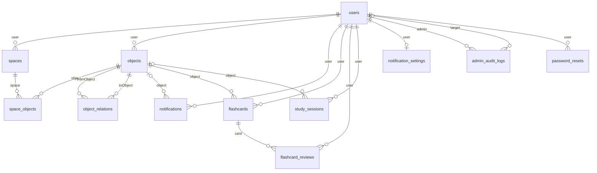

# 06_Database_Design.md — Thiết kế cơ sở dữ liệu

> Tài liệu trước: [04_System_Architecture.md](04_System_Architecture.md) và [05_Domain_Model.md](05_Domain_Model.md)
> Tài liệu sau: [07_API_Design.md](07_API_Design.md)
>
> **Tài liệu này được SINH TỰ ĐỘNG từ `backend/prisma/schema.prisma` và `backend/prisma/migrations/`** (không sửa tay; chạy lại bộ sinh khi schema đổi) nên luôn khớp với mã nguồn.

---

## 1. Tổng quan

- Hệ quản trị: **PostgreSQL 16**, truy cập qua **Prisma ORM 5**; lược đồ thay đổi bằng **migration** có đánh số (`prisma/migrations/`), không dùng `db push`.
- **12 bảng**, **7 kiểu liệt kê (enum)**. Quy ước: tên bảng/cột `snake_case`, khoá chính UUID, thời gian `TIMESTAMPTZ`.
- Nguyên tắc cốt lõi: **Object** là bảng dùng chung cho 4 loại nội dung (Task, Note, Event, Reference) — xem Decision Log trong doc 04. **Space** không sở hữu Object; quan hệ nhiều–nhiều qua `space_objects`.
- Dữ liệu của mỗi người dùng luôn gắn với `user_id`; mọi truy vấn ở backend đều lọc theo người dùng hiện tại (kiểm thử bằng test cách ly dữ liệu, xem doc 10).

## 2. Sơ đồ ERD

> Sơ đồ vẽ tay (draw.io) ở `diagrams/06_ERD.drawio` là bản cũ (8 bảng, còn Tag) — cần xuất lại khi chốt báo cáo; sơ đồ Mermaid ở trên là bản đúng với mã nguồn.

---

## 3. Từ điển dữ liệu

### 3.1. Bảng `users`

| Cột | Kiểu | Null | Mặc định | Ghi chú |
|---|---|:-:|---|---|
| `id` | UUID |  | gen_random_uuid() | Khoá chính |
| `email` | VARCHAR(255) |  | — | Duy nhất |
| `password_hash` | VARCHAR(255) |  | — |  |
| `full_name` | VARCHAR(100) |  | — |  |
| `avatar_url` | TEXT | ✓ | — |  |
| `role` | ENUM `Role` |  | `USER` |  |
| `locked_at` | TIMESTAMPTZ | ✓ | — |  |
| `failed_login_count` | INTEGER |  | `0` |  |
| `lockout_until` | TIMESTAMPTZ | ✓ | — |  |
| `last_login_at` | TIMESTAMPTZ | ✓ | — |  |
| `created_at` | TIMESTAMPTZ |  | NOW() |  |
| `updated_at` | TIMESTAMPTZ |  | — |  |
| `calendar_token` | VARCHAR(64) | ✓ | — | Duy nhất |

### 3.2. Bảng `spaces`

| Cột | Kiểu | Null | Mặc định | Ghi chú |
|---|---|:-:|---|---|
| `id` | UUID |  | gen_random_uuid() | Khoá chính |
| `user_id` | UUID |  | — | FK → `users.id` (xoá theo) |
| `name` | VARCHAR(100) |  | — |  |
| `description` | TEXT | ✓ | — |  |
| `icon` | VARCHAR(50) |  | `📁` |  |
| `color` | VARCHAR(20) |  | `#6366f1` |  |
| `settings` | JSONB |  | `{}` |  |
| `goal` | TEXT | ✓ | — |  |
| `due_date` | TIMESTAMPTZ | ✓ | — |  |
| `archived_at` | TIMESTAMPTZ | ✓ | — |  |
| `created_at` | TIMESTAMPTZ |  | NOW() |  |
| `updated_at` | TIMESTAMPTZ |  | — |  |

- Chỉ mục: (user_id, archived_at)

### 3.3. Bảng `objects`

| Cột | Kiểu | Null | Mặc định | Ghi chú |
|---|---|:-:|---|---|
| `id` | UUID |  | gen_random_uuid() | Khoá chính |
| `user_id` | UUID |  | — | FK → `users.id` (xoá theo) |
| `type` | ENUM `ObjectType` |  | — |  |
| `title` | VARCHAR(255) |  | — |  |
| `description` | TEXT | ✓ | — |  |
| `status` | ENUM `TaskStatus` | ✓ | — |  |
| `priority` | ENUM `Priority` | ✓ | — |  |
| `lifecycle` | ENUM `ObjectLifecycle` |  | `ACTIVE` |  |
| `due_date` | TIMESTAMPTZ | ✓ | — |  |
| `start_at` | TIMESTAMPTZ | ✓ | — |  |
| `end_at` | TIMESTAMPTZ | ✓ | — |  |
| `url` | TEXT | ✓ | — |  |
| `recurrence` | JSONB | ✓ | — |  |
| `recurrence_spawned` | BOOLEAN |  | `false` |  |
| `completed_at` | TIMESTAMPTZ | ✓ | — |  |
| `estimated_minutes` | INTEGER | ✓ | — |  |
| `metadata` | JSONB |  | `{}` |  |
| `archived_at` | TIMESTAMPTZ | ✓ | — |  |
| `deleted_at` | TIMESTAMPTZ | ✓ | — |  |
| `created_at` | TIMESTAMPTZ |  | NOW() |  |
| `updated_at` | TIMESTAMPTZ |  | — |  |

- Chỉ mục: (user_id, lifecycle)
- Chỉ mục: (user_id, type)
- Chỉ mục: (user_id, due_date)
- Chỉ mục: (user_id, start_at)

### 3.4. Bảng `space_objects`

| Cột | Kiểu | Null | Mặc định | Ghi chú |
|---|---|:-:|---|---|
| `id` | UUID |  | gen_random_uuid() | Khoá chính |
| `space_id` | UUID |  | — | FK → `spaces.id` (xoá theo) |
| `object_id` | UUID |  | — | FK → `objects.id` (xoá theo) |
| `position` | INTEGER |  | `0` |  |
| `is_pinned` | BOOLEAN |  | `false` |  |
| `added_at` | TIMESTAMPTZ |  | NOW() |  |

- Duy nhất: (space_id, object_id)
- Chỉ mục: (space_id, position)

### 3.5. Bảng `object_relations`

| Cột | Kiểu | Null | Mặc định | Ghi chú |
|---|---|:-:|---|---|
| `id` | UUID |  | gen_random_uuid() | Khoá chính |
| `from_object_id` | UUID |  | — | FK → `objects.id` (xoá theo) |
| `to_object_id` | UUID |  | — | FK → `objects.id` (xoá theo) |
| `relation_type` | ENUM `RelationType` |  | `RELATES_TO` |  |
| `auto` | BOOLEAN |  | `false` |  |
| `created_at` | TIMESTAMPTZ |  | NOW() |  |

- Duy nhất: (from_object_id, to_object_id, relation_type)
- Chỉ mục: (to_object_id)

### 3.6. Bảng `notifications`

| Cột | Kiểu | Null | Mặc định | Ghi chú |
|---|---|:-:|---|---|
| `id` | UUID |  | gen_random_uuid() | Khoá chính |
| `user_id` | UUID |  | — | FK → `users.id` (xoá theo) |
| `object_id` | UUID | ✓ | — | FK → `objects.id` (xoá theo) |
| `type` | VARCHAR(50) |  | `GENERAL` |  |
| `title` | VARCHAR(255) |  | — |  |
| `message` | TEXT |  | — |  |
| `data` | JSONB |  | `{}` |  |
| `dedupe_key` | VARCHAR(100) | ✓ | — |  |
| `is_read` | BOOLEAN |  | `false` |  |
| `read_at` | TIMESTAMPTZ | ✓ | — |  |
| `created_at` | TIMESTAMPTZ |  | NOW() |  |

- Duy nhất: (user_id, dedupe_key)
- Chỉ mục: (user_id, is_read)

### 3.7. Bảng `flashcards`

Thẻ hỏi–đáp sinh từ Note (dòng "Câu hỏi :: Trả lời"), ôn theo SM-2.

| Cột | Kiểu | Null | Mặc định | Ghi chú |
|---|---|:-:|---|---|
| `id` | UUID |  | gen_random_uuid() | Khoá chính |
| `user_id` | UUID |  | — | FK → `users.id` (xoá theo) |
| `object_id` | UUID |  | — | FK → `objects.id` (xoá theo) |
| `front` | VARCHAR(500) |  | — |  |
| `back` | VARCHAR(2000) |  | — |  |
| `ease_factor` | DOUBLE PRECISION |  | `2.5` |  |
| `interval_days` | INTEGER |  | `0` |  |
| `repetitions` | INTEGER |  | `0` |  |
| `due_at` | TIMESTAMPTZ |  | NOW() |  |
| `last_reviewed_at` | TIMESTAMPTZ | ✓ | — |  |
| `created_at` | TIMESTAMPTZ |  | NOW() |  |
| `updated_at` | TIMESTAMPTZ |  | — |  |

- Duy nhất: (object_id, front)
- Chỉ mục: (user_id, due_at)

### 3.8. Bảng `flashcard_reviews`

Lịch sử mỗi lần ôn (phục vụ thống kê và chuỗi ngày học).

| Cột | Kiểu | Null | Mặc định | Ghi chú |
|---|---|:-:|---|---|
| `id` | UUID |  | gen_random_uuid() | Khoá chính |
| `card_id` | UUID |  | — | FK → `flashcards.id` (xoá theo) |
| `user_id` | UUID |  | — | FK → `users.id` (xoá theo) |
| `grade` | ENUM `ReviewGrade` |  | — |  |
| `interval_after` | INTEGER |  | — |  |
| `ease_after` | DOUBLE PRECISION |  | — |  |
| `reviewed_at` | TIMESTAMPTZ |  | NOW() |  |

- Chỉ mục: (user_id, reviewed_at)

### 3.9. Bảng `study_sessions`

Phiên học tập trung (Pomodoro) — thời gian học thật.

| Cột | Kiểu | Null | Mặc định | Ghi chú |
|---|---|:-:|---|---|
| `id` | UUID |  | gen_random_uuid() | Khoá chính |
| `user_id` | UUID |  | — | FK → `users.id` (xoá theo) |
| `object_id` | UUID | ✓ | — | FK → `objects.id` (đặt NULL) |
| `minutes` | INTEGER |  | — |  |
| `created_at` | TIMESTAMPTZ |  | NOW() |  |

- Chỉ mục: (user_id, created_at)

### 3.10. Bảng `notification_settings`

Cài đặt thông báo của mỗi người dùng (1 dòng / người).

| Cột | Kiểu | Null | Mặc định | Ghi chú |
|---|---|:-:|---|---|
| `user_id` | UUID |  | — | Khoá chính; FK → `users.id` (xoá theo) |
| `remind_before_minutes` | INTEGER |  | `1440` |  |
| `quiet_hours_enabled` | BOOLEAN |  | `false` |  |
| `quiet_start_minute` | INTEGER |  | `1380` |  |
| `quiet_end_minute` | INTEGER |  | `420` |  |
| `enable_deadline` | BOOLEAN |  | `true` |  |
| `enable_overdue` | BOOLEAN |  | `true` |  |
| `enable_event` | BOOLEAN |  | `true` |  |
| `enable_digest` | BOOLEAN |  | `true` |  |
| `enable_study` | BOOLEAN |  | `true` |  |
| `enable_unblocked` | BOOLEAN |  | `true` |  |

### 3.11. Bảng `admin_audit_logs`

Nhật ký hành động quản trị (ai khoá/mở khoá ai, phát thông báo...). Không chứa nội dung cá nhân.

| Cột | Kiểu | Null | Mặc định | Ghi chú |
|---|---|:-:|---|---|
| `id` | UUID |  | gen_random_uuid() | Khoá chính |
| `admin_id` | UUID |  | — | FK → `users.id` (xoá theo) |
| `action` | VARCHAR(50) |  | — |  |
| `target_user_id` | UUID | ✓ | — | FK → `users.id` (đặt NULL) |
| `detail` | VARCHAR(255) |  | `` |  |
| `created_at` | TIMESTAMPTZ |  | NOW() |  |

- Chỉ mục: (created_at)

### 3.12. Bảng `password_resets`

Chỉ lưu BĂM của token (không lưu token gốc) → lộ CSDL cũng không dùng được để đặt lại mật khẩu.

| Cột | Kiểu | Null | Mặc định | Ghi chú |
|---|---|:-:|---|---|
| `id` | UUID |  | gen_random_uuid() | Khoá chính |
| `user_id` | UUID |  | — | FK → `users.id` (xoá theo) |
| `token_hash` | VARCHAR(64) |  | — | Duy nhất |
| `expires_at` | TIMESTAMPTZ |  | — |  |
| `used_at` | TIMESTAMPTZ | ✓ | — |  |
| `created_at` | TIMESTAMPTZ |  | NOW() |  |

- Chỉ mục: (user_id)

---

## 4. Kiểu liệt kê (enum)

| Enum | Giá trị |
|---|---|
| `Role` | `USER`, `ADMIN` |
| `ObjectType` | `TASK`, `NOTE`, `EVENT`, `REFERENCE` |
| `TaskStatus` | `TODO`, `IN_PROGRESS`, `DONE`, `CANCELLED` |
| `Priority` | `LOW`, `MEDIUM`, `HIGH`, `URGENT` |
| `ObjectLifecycle` | `ACTIVE`, `ARCHIVED`, `TRASH` |
| `ReviewGrade` | `AGAIN`, `HARD`, `GOOD`, `EASY` |
| `RelationType` | `RELATES_TO`, `DEPENDS_ON`, `REFERENCES`, `PARENT_OF` |

---

## 5. Ràng buộc toàn vẹn ở mức CSDL (`CHECK`)

Prisma không tự sinh `CHECK`, nên các ràng buộc này được viết tay trong migration. Chúng đảm bảo dữ liệu sai bị CSDL từ chối **kể cả khi đi đường tắt** (SQL trực tiếp) — có test kiểm chứng.

| Bảng | Tên ràng buộc | Điều kiện |
|---|---|---|
| `objects` | `objects_event_has_start` | `type <> 'EVENT' OR start_at IS NOT NULL` |
| `objects` | `objects_reference_has_url` | `type <> 'REFERENCE' OR url IS NOT NULL` |
| `objects` | `objects_time_order` | `start_at IS NULL OR end_at IS NULL OR end_at > start_at` |
| `objects` | `objects_status_only_task` | `type = 'TASK' OR status IS NULL` |
| `objects` | `objects_priority_task_event` | `type IN ('TASK', 'EVENT') OR priority IS NULL` |
| `object_relations` | `object_relations_no_self` | `from_object_id <> to_object_id` |
| `objects` | `objects_estimate_only_task` | `type = 'TASK' OR estimated_minutes IS NULL` |
| `study_sessions` | `study_sessions_minutes_range` | `minutes BETWEEN 1 AND 240` |
| `flashcards` | `flashcards_ease_min` | `ease_factor >= 1.3` |
| `flashcards` | `flashcards_nonneg` | `interval_days >= 0 AND repetitions >= 0` |
| `notification_settings` | `notif_remind_range` | `remind_before_minutes BETWEEN 5 AND 10080` |
| `notification_settings` | `notif_quiet_range` | `quiet_start_minute BETWEEN 0 AND 1439 AND quiet_end_minute BETWEEN 0 AND 1439` |
| `objects` | `objects_recurrence_task_event` | `type IN ('TASK', 'EVENT') OR recurrence IS NULL` |

## 6. Lịch sử migration

| # | Migration |
|--:|---|
| 1 | `20261024000000_init` |
| 2 | `20261024000100_constraints` |
| 3 | `20261024165528_planning_estimated_minutes` |
| 4 | `20261024170421_study_flashcards_sessions` |
| 5 | `20261024171453_relation_auto_mentions` |
| 6 | `20261024172153_notification_settings` |
| 7 | `20261024172815_admin_audit_logs` |
| 8 | `20261025074225_login_lockout` |
| 9 | `20261025074903_recurrence` |
| 10 | `20261025075243_password_resets` |
| 11 | `20261025075701_completed_at` |
| 12 | `20261025080000_calendar_token` |

---

*Tiếp theo: [07_API_Design.md](07_API_Design.md)*  
*Quay lại mục lục: [docs/README.md](README.md)*
